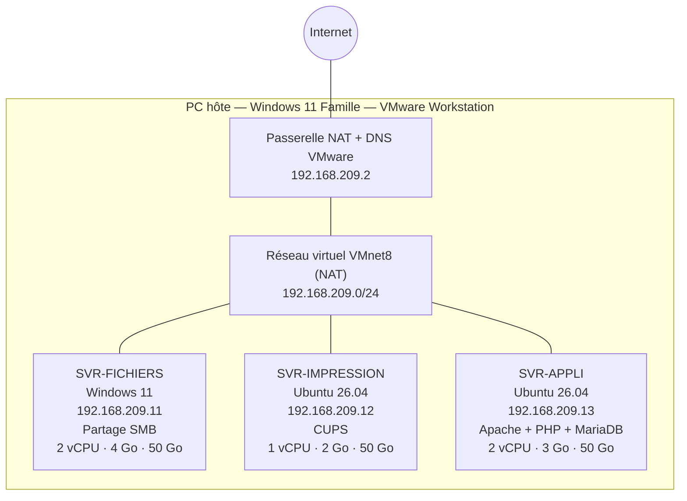

# Projet 1 — Infrastructure virtuelle pour une PME

**Cours :** Virtualisation — Mettre en place et exploiter une plateforme de virtualisation
**Classe :** E1A — Geneva Institute of Technology
**Auteure :** Rrudhani Deaa
**Date :** octobre 2026

---
### Sommaire

[TOC]

---
## 1. Contexte

Une PME de 15 salariés veut virtualiser ses 3 serveurs physiques (fichiers, impression, applicatif) pour réduire ses coûts matériels. L'objectif est de faire tourner ces 3 serveurs sous forme de machines virtuelles sur un seul hôte.

## 2. Objectifs

- Installer un hyperviseur.
- Créer 3 VM avec des rôles distincts.
- Configurer un réseau virtuel où les VM communiquent entre elles et avec l'extérieur.
- Allouer les ressources (CPU, RAM, disque) selon le rôle de chaque VM.
- Valider le fonctionnement et documenter l'architecture.

---

## 3. Choix de l'hyperviseur

**Hyperviseur retenu : VMware Workstation 17 Pro** (version 17.5.2, build 23775571), installé sur un PC portable sous **Windows 11 Famille** (16 Go de RAM).

| Solution | Pourquoi elle n'a pas été retenue |
| --- | --- |
| Hyper-V | Non disponible sur Windows 11 Famille |
| Proxmox VE | Testé au Projet 5 : en virtualisation imbriquée sur ce PC, il tourne sans accélération matérielle (KVM), donc beaucoup trop lentement pour 3 serveurs |
| **VMware Workstation** |  Déjà installé, stable et performant sur ce PC |

> En production, on utiliserait un hyperviseur de **type 1** installé directement sur un serveur physique (par exemple Proxmox VE, recommandé au Projet 5). VMware Workstation (type 2) sert ici d'environnement de maquette.


---

## 4. Architecture

### 4.1 Schéma



### 4.2 Plan d'adressage

| Élément | Adresse IP | Masque | Passerelle | DNS |
| --- | --- | --- | --- | --- |
| Réseau VMnet8 (NAT) | 192.168.209.0 | /24 (255.255.255.0) | — | — |
| Passerelle NAT VMware | 192.168.209.2 | /24 | — | — |
| SVR-FICHIERS | 192.168.209.11 | /24 | 192.168.209.2 | 192.168.209.2 |
| SVR-IMPRESSION | 192.168.209.12 | /24 | 192.168.209.2 | 192.168.209.2 |
| SVR-APPLI | 192.168.209.13 | /24 | 192.168.209.2 | 192.168.209.2 |

**Pourquoi le mode NAT :** les 3 VM sont sur le même réseau virtuel, donc elles communiquent directement entre elles, et la passerelle NAT de VMware leur donne accès à Internet. Les adresses sont **fixes**, car un serveur doit toujours être joignable à la même adresse.

### 4.3 Allocation des ressources

| VM | vCPU | RAM | Disque | Justification |
| --- | --- | --- | --- | --- |
| SVR-FICHIERS | 2 | 4 Go | 50 Go | Windows 11 demande au minimum 4 Go de RAM ; le disque stocke les fichiers des 15 salariés |
| SVR-IMPRESSION | 1 | 2 Go | 50 Go | Le service CUPS est très léger ; 2 Go car c'est un Ubuntu avec interface graphique |
| SVR-APPLI | 2 | 3 Go | 50 Go | Apache + PHP + base de données MariaDB : c'est la VM la plus sollicitée |
| **Total** | **5** | **9 Go** | **150 Go** | VMware autorise jusqu'à 12,9 Go de RAM pour les VM sur ce PC : il reste de la marge |

Les disques sont en **allocation dynamique** : ils n'occupent sur l'hôte que l'espace réellement utilisé (environ 10 Go chacun pour les Ubuntu). Ils sont restés à 50 Go car les VM ont été réutilisées et qu'un disque virtuel ne se réduit pas facilement.


---

## 5. Réalisation

Les 3 VM ont été créées à partir de VM existantes, puis renommées et reconfigurées pour leur nouveau rôle :

| VM d'origine | Nouvelle VM | OS |
| --- | --- | --- |
| PC01_WIN11 (VM fournie par l'enseignant) | SVR-FICHIERS | Windows 11 |
| SRV.PHY | SVR-IMPRESSION | Ubuntu 26.04 (avec interface graphique) |
| SRV-VM | SVR-APPLI | Ubuntu 26.04 (avec interface graphique) |

Dans VMware, chaque VM a été renommée via **Settings → Options → General → Virtual machine name**.

### 5.1 SVR-IMPRESSION (serveur d'impression)

**a) Nom de la machine**

```bash
sudo hostnamectl set-hostname svr-impression
sudo nano /etc/hosts
```

Dans `/etc/hosts`, la ligne `127.0.1.1` a été mise à jour avec le nouveau nom.


**b) Adresse IP fixe**

La VM avait déjà une IP fixe (`192.168.209.50`) dans `/etc/netplan/01-srv.yaml`. Elle a été remplacée par `192.168.209.12` :

```bash
sudo sed -i 's/192.168.209.50/192.168.209.12/' /etc/netplan/01-srv.yaml
sudo cat /etc/netplan/01-srv.yaml
sudo netplan apply
```

Contenu final :

```yaml
network: {version: 2, renderer: NetworkManager, ethernets: {ens33: {dhcp4: false, addresses: [192.168.209.12/24], routes: [{to: default, via: 192.168.209.2}], nameservers: {addresses: [192.168.209.2]}}}}
```


**c) Installation de CUPS et d'une imprimante virtuelle PDF**

Comme il n'y a pas d'imprimante physique, une **imprimante virtuelle PDF** a été installée pour valider le service.

```bash
sudo apt update
sudo apt install cups printer-driver-cups-pdf -y
sudo usermod -aG lpadmin dea
sudo cupsctl --remote-admin --remote-any --share-printers
sudo systemctl restart cups
systemctl status cups
```

| Commande | Rôle |
| --- | --- |
| `usermod -aG lpadmin dea` | Donne à l'utilisateur les droits d'administration des imprimantes |
| `cupsctl --remote-admin --remote-any --share-printers` | Autorise l'administration et l'impression depuis le réseau |


service **active (running)**.

**d) Test d'impression**

```bash
lpstat -p
echo "Test impression SVR-IMPRESSION" | lp -d PDF
ls ~/PDF
```

Le fichier `stdin___PDF-job_1.pdf` a été créé : l'impression fonctionne.


**e) Accès depuis le réseau**

L'interface web de CUPS est accessible depuis le PC hôte à l'adresse **http://192.168.209.12:631**.


### 5.2 SVR-FICHIERS (serveur de fichiers)

Toutes les commandes ont été lancées dans **PowerShell en administrateur**.

**a) Nom de la machine**

```powershell
Rename-Computer -NewName "SVR-FICHIERS"
```

 Erreur : *« Le domaine spécifié n'existe pas ou n'a pas pu être contacté »*. La VM est membre du domaine **satomit.local** (VM fournie par l'enseignant), dont le contrôleur n'est pas disponible. Pour ne pas modifier la VM de l'enseignant, le nom Windows **PC01** a été conservé ; seul le nom de la VM dans VMware a été changé en `SVR-FICHIERS`.


**b) Adresse IP fixe**

La VM avait déjà une IP fixe (`192.168.209.22`) avec des DNS publics. Elle a été remplacée par `192.168.209.11` :

```powershell
Get-NetAdapter
New-NetIPAddress -InterfaceAlias "Ethernet0" -IPAddress 192.168.209.11 -PrefixLength 24
Remove-NetIPAddress -IPAddress 192.168.209.22 -Confirm:$false
Set-DnsClientServerAddress -InterfaceAlias "Ethernet0" -ServerAddresses 192.168.209.2
Get-NetIPConfiguration -InterfaceAlias "Ethernet0"
```


Nouvelle


**c) Pare-feu**

```powershell
Set-NetConnectionProfile -InterfaceAlias "Ethernet0" -NetworkCategory Private
Enable-NetFirewallRule -Group "@FirewallAPI.dll,-28502"
New-NetFirewallRule -DisplayName "Autoriser ping ICMPv4" -Protocol ICMPv4 -IcmpType 8 -Direction Inbound -Action Allow
```

| Commande | Rôle |
| --- | --- |
| `Set-NetConnectionProfile ... Private` | Passe le réseau en « Privé » (Windows bloque le partage en réseau « Public ») |
| `Enable-NetFirewallRule -Group ...-28502` | Active les règles « Partage de fichiers et d'imprimantes » (identifiant interne, indépendant de la langue) |
| `New-NetFirewallRule ... ICMPv4` | Autorise le ping entrant, pour que les autres VM puissent tester la connexion |


**d) Création du partage**

```powershell
New-Item -Path "C:\Partage" -ItemType Directory
New-SmbShare -Name "Fichiers" -Path "C:\Partage" -ChangeAccess "Tout le monde"
icacls "C:\Partage" /grant "*S-1-1-0:(OI)(CI)M"
Get-SmbShare
```

Le partage s'appelle **Fichiers** (le nom « Partage » existait déjà sur la VM). Chemin réseau : **`\\192.168.209.11\Fichiers`**.

| Commande | Rôle |
| --- | --- |
| `New-SmbShare ... -ChangeAccess "Tout le monde"` | Partage le dossier sur le réseau en lecture/écriture |
| `icacls ... /grant "*S-1-1-0:(OI)(CI)M"` | Donne le droit « Modifier » sur le dossier et son contenu (`S-1-1-0` = « Tout le monde ») |


**e) Compte d'accès**

Le compte de la VM étant un compte du domaine (injoignable), un **compte local `employe`** est utilisé pour se connecter au partage depuis le réseau (`PC01\employe`).

### 5.3 SVR-APPLI (serveur applicatif)

**a) Nom de la machine, IP fixe et identifiant**

SVR-APPLI étant un **clone** de la même VM que SVR-IMPRESSION, elle avait le même nom (`srv-web`), la même IP (`.50`) et le même identifiant machine. Les trois ont été changés :

```bash
sudo hostnamectl set-hostname svr-appli
sudo sed -i 's/srv-web/svr-appli/' /etc/hosts
sudo sed -i 's/192.168.209.50/192.168.209.13/' /etc/netplan/01-srv.yaml
sudo rm /etc/machine-id
sudo systemd-machine-id-setup
sudo netplan apply
sudo systemctl reboot -i
```


#### Autoriser le ping sur SVR-FICHIERS

Par défaut, le pare-feu Windows bloque les pings entrants. SVR-APPLI n'arrivait donc pas à pinguer SVR-FICHIERS, alors que le partage de fichiers fonctionnait. Cette commande crée une règle qui autorise les demandes de ping entrantes :

```powershell
New-NetFirewallRule -DisplayName "Autoriser ping ICMPv4" -Protocol ICMPv4 -IcmpType 8 -Direction Inbound -Action Allow
```

| Paramètre | Signification |
| --- | --- |
| `New-NetFirewallRule` | Crée une nouvelle règle dans le pare-feu |
| `-DisplayName "Autoriser ping ICMPv4"` | Nom de la règle, tel qu'il apparaît dans le pare-feu Windows |
| `-Protocol ICMPv4` | Protocole concerné : ICMP est le protocole utilisé par `ping` (en IPv4) |
| `-IcmpType 8` | Type 8 = **demande d'écho** (« Echo Request »), le message envoyé par un `ping` |
| `-Direction Inbound` | La règle s'applique au trafic **entrant** (vers SVR-FICHIERS) |
| `-Action Allow` | Le trafic est **autorisé** |

La réponse au ping (type 0, « Echo Reply ») part ensuite automatiquement, car le pare-feu laisse sortir les réponses aux demandes entrantes.


**b) Installation d'Apache, PHP et MariaDB**

```bash
sudo apt update
sudo apt install apache2 php libapache2-mod-php mariadb-server php-mysql -y
echo "ServerName svr-appli" | sudo tee /etc/apache2/conf-available/servername.conf
sudo a2enconf servername
sudo systemctl reload apache2
systemctl status apache2
systemctl status mariadb
```


**c) Page de l'application**

L'ancienne page (`index.html` du Projet 4) a été renommée en `index.html.old`, et une page PHP a été créée dans `/var/www/html/index.php` :

```php
<?php
echo "<h1>SVR-APPLI - Application de la PME</h1>";
echo "<p>Serveur : " . gethostname() . "</p>";
echo "<p>Adresse IP : " . $_SERVER['SERVER_ADDR'] . "</p>";
echo "<p>Date : " . date('d/m/Y H:i') . "</p>";
echo "<p>Version PHP : " . phpversion() . "</p>";
?>
```
Avant commande

Résultat final 


---

## 6. Tests de validation

| # | Test | Depuis | Vers | Résultat |
| --- | --- | --- | --- | --- |
| 1 | Ping passerelle + Internet | SVR-IMPRESSION | 192.168.209.2 / google.com | ✅ |
| 2 | Ping entre VM + Internet | SVR-FICHIERS | SVR-IMPRESSION / google.com | ✅ |
| 3 | Ping entre VM + Internet | SVR-APPLI | SVR-FICHIERS, SVR-IMPRESSION / google.com | ✅ |
| 4 | Impression test (PDF) | SVR-IMPRESSION | Imprimante virtuelle PDF | ✅ fichier PDF créé |
| 5 | Interface web CUPS | PC hôte | http://192.168.209.12:631 | ✅ |
| 6 | Accès au partage + création d'un fichier | PC hôte | `\\192.168.209.11\Fichiers` | ✅ `test-hote.txt` visible dans `C:\Partage` |
| 7 | Accès au partage depuis une autre VM | SVR-IMPRESSION (`smbclient`) | `//192.168.209.11/Fichiers` | ✅ `test-hote.txt` visible |
| 8 | Page de l'application | PC hôte | http://192.168.209.13 | ✅ page PHP affichée |

Commande du test 7 :

```bash
smbclient //192.168.209.11/Fichiers -U PC01/employe
```


**Conclusion des tests :** les 3 VM sont opérationnelles, communiquent entre elles et avec Internet, et chaque service est accessible depuis le réseau.

---

## 7. Fiches de configuration

### Fiche 1 — SVR-FICHIERS

| Élément | Valeur |
| --- | --- |
| Rôle | Serveur de fichiers |
| Système | Windows 11 |
| Nom VMware / nom Windows | SVR-FICHIERS / PC01 (membre du domaine `satomit.local`) |
| vCPU / RAM / Disque | 2 / 4 Go / 50 Go (NVMe, dynamique) |
| Carte réseau | NAT (VMnet8) — `Ethernet0` |
| Adresse IP | 192.168.209.11/24 (fixe) |
| Passerelle / DNS | 192.168.209.2 / 192.168.209.2 |
| Service | Partage SMB `Fichiers` → `C:\Partage` |
| Chemin réseau | `\\192.168.209.11\Fichiers` |
| Droits | « Tout le monde » : modification (partage + NTFS) |
| Compte d'accès réseau | `PC01\employe` (compte local) |
| Pare-feu | Partage de fichiers et d'imprimantes + ping ICMPv4 autorisés |

### Fiche 2 — SVR-IMPRESSION

| Élément | Valeur |
| --- | --- |
| Rôle | Serveur d'impression |
| Système | Ubuntu 26.04 LTS (avec interface graphique) |
| Nom d'hôte | svr-impression |
| vCPU / RAM / Disque | 1 / 2 Go / 50 Go (dynamique) |
| Carte réseau | NAT (VMnet8) — `ens33` |
| Adresse IP | 192.168.209.12/24 (fixe, `/etc/netplan/01-srv.yaml`) |
| Passerelle / DNS | 192.168.209.2 / 192.168.209.2 |
| Service | CUPS 2.4.16 |
| Imprimante | `PDF` (imprimante virtuelle, fichiers dans `~/PDF`) |
| Administration | http://192.168.209.12:631 |
| Options réseau | Administration à distance + partage des imprimantes activés |

### Fiche 3 — SVR-APPLI

| Élément | Valeur |
| --- | --- |
| Rôle | Serveur applicatif (application web) |
| Système | Ubuntu 26.04 LTS (avec interface graphique) |
| Nom d'hôte | svr-appli |
| vCPU / RAM / Disque | 2 / 3 Go / 50 Go (dynamique) |
| Carte réseau | NAT (VMnet8) — `ens33` |
| Adresse IP | 192.168.209.13/24 (fixe, `/etc/netplan/01-srv.yaml`) |
| Passerelle / DNS | 192.168.209.2 / 192.168.209.2 |
| Services | Apache 2.4.66, PHP 8.5.4, MariaDB 11.8.6 |
| Dossier du site | `/var/www/html/` (page `index.php`) |
| Accès | http://192.168.209.13 |

---

## 8. Difficultés rencontrées

| Problème | Cause | Solution |
| --- | --- | --- |
| Impossible de renommer SVR-FICHIERS | VM membre du domaine `satomit.local`, contrôleur absent | Nom Windows `PC01` conservé, VM renommée seulement dans VMware |
| `Enable-NetFirewallRule -DisplayGroup "..."` introuvable | Nom du groupe différent selon la langue de Windows | Utilisation de l'identifiant interne `@FirewallAPI.dll,-28502` |
| `New-SmbShare` : « nom de partage existe déjà » | Un partage `Partage` existait déjà sur la VM | Partage créé sous le nom `Fichiers` |
| `New-SmbShare ... "Everyone"` : erreur de relation d'approbation | Windows en français : « Everyone » n'existe pas localement et Windows le cherche dans le domaine | Utilisation de « Tout le monde » et du SID `S-1-1-0` |
| `New-NetIPAddress` : « DefaultGateway already exists » | La passerelle était déjà configurée | Ajout de l'IP sans `-DefaultGateway` |
| Ping vers SVR-FICHIERS bloqué depuis SVR-APPLI | Pare-feu Windows | Règle ICMPv4 entrante ajoutée |
| SVR-IMPRESSION et SVR-APPLI avec le même nom et la même IP | Clones de la même VM | Nouveau nom, nouvelle IP et nouvel identifiant machine (`machine-id`) |
| `sudo reboot` refusé | Session graphique GNOME ouverte | `sudo systemctl reboot -i` |
| Ancienne page web affichée sur SVR-APPLI | `index.html` est prioritaire sur `index.php` | `index.html` renommé en `index.html.old` |

---

## 9. Limites et améliorations possibles

**Limites :**
- VMware Workstation est un hyperviseur de **type 2** : adapté à une maquette, pas à la production.
- Les deux Ubuntu ont une **interface graphique**, inutile sur un serveur et consommatrice de ressources.
- SVR-FICHIERS tourne sous **Windows 11**, qui n'est pas un système serveur, et reste membre d'un domaine injoignable.
- Pas d'imprimante physique : le service d'impression a été validé avec une imprimante virtuelle PDF.
- L'heure affichée par PHP est en UTC (2 h de décalage).

**Améliorations :**
- Installer un hyperviseur de type 1 (Proxmox VE) sur un serveur physique dédié.
- Utiliser **Ubuntu Server** (sans interface graphique) pour SVR-IMPRESSION et SVR-APPLI.
- Utiliser **Windows Server** ou **Samba** pour le serveur de fichiers, avec des comptes par employé et des droits par dossier.
- Mettre en place des **snapshots** et une **sauvegarde** régulière des 3 VM.
- Régler le fuseau horaire de PHP (`date.timezone = Europe/Zurich`).

---

## 10. Liste des captures

| N° | Fichier | Contenu |
| --- | --- | --- |
| 01 | `01_vmware_version.png` | Version de VMware Workstation |
| 02 | `02_settings_svr_fichiers.png` | Ressources de SVR-FICHIERS |
| 03 | `03_settings_svr_impression.png` | Ressources de SVR-IMPRESSION |
| 04 | `04_settings_svr_appli.png` | Ressources de SVR-APPLI |
| 05 | `05_impression_hostname.png` | Renommage de SVR-IMPRESSION |
| 06 | `06_impression_ip.png` | IP fixe + pings SVR-IMPRESSION |
| 07 | `07_impression_install_cups.png` | Installation de CUPS |
| 08 | `08_impression_status_cups.png` | Service CUPS actif |
| 09 | `09_impression_test_pdf.png` | Test d'impression PDF |
| 10 | `10_impression_interface_web.png` | Interface web CUPS depuis l'hôte |
| 11 | `11_fichiers_erreur_domaine.png` | Erreur de renommage (domaine) |
| 12 | `12_fichiers_ip_avant.png` | IP de SVR-FICHIERS avant (.22) |
| 13 | `13_fichiers_ip_apres.png` | IP de SVR-FICHIERS après (.11) |
| 14 | `14_fichiers_pings.png` | Pings depuis SVR-FICHIERS |
| 15 | `15_fichiers_parefeu.png` | Règles du pare-feu |
| 16 | `16_fichiers_partage.png` | Partage `Fichiers` créé |
| 17 | `17_appli_config.png` | Nom, IP et machine-id de SVR-APPLI |
| 18 | `18_appli_ip_pings.png` | IP + pings depuis SVR-APPLI |
| 19 | `19_appli_install.png` | Installation Apache, PHP, MariaDB |
| 20 | `20_appli_status_apache.png` | Service Apache actif |
| 21 | `21_appli_status_mariadb.png` | Service MariaDB actif |
| 22 | `22_appli_page_web.png` | Page de l'application depuis l'hôte |
| 23 | `23_test_partage_hote.png` | Partage ouvert depuis l'hôte |
| 24 | `24_test_partage_fichier_vm.png` | Fichier test dans `C:\Partage` |
| 25 | `25_test_smbclient.png` | Accès au partage depuis SVR-IMPRESSION |

---

*Rrudhani Deaa — E1A — Geneva Institute of Technology*