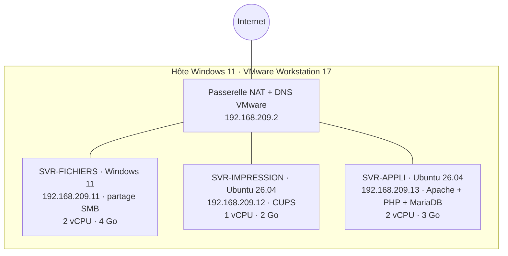

# 01 — Infrastructure virtuelle pour une PME de 15 salariés

## Objectif
Remplacer 3 serveurs physiques (fichiers, impression, applicatif) par 3 machines virtuelles sur un seul hôte, avec un réseau commun, des ressources dimensionnées par rôle et une documentation exploitable.

## Architecture

| VM | Rôle | IP fixe | vCPU / RAM / disque |
|---|---|---|---|
| SVR-FICHIERS | Partage SMB `\\192.168.209.11\Fichiers` | .11/24 | 2 / 4 Go / 50 Go |
| SVR-IMPRESSION | CUPS + imprimante virtuelle PDF | .12/24 | 1 / 2 Go / 50 Go |
| SVR-APPLI | Application web PHP, base MariaDB | .13/24 | 2 / 3 Go / 50 Go |

Disques en allocation dynamique ; total 5 vCPU / 9 Go de RAM, avec marge sur l'hôte.

## Étapes clés
- **Ubuntu** : `hostnamectl`, IP fixe via netplan, régénération du `machine-id` sur la VM clonée (évite deux machines avec la même identité).
- **CUPS** : installation, imprimante PDF, administration à distance (`cupsctl`), test `lp`.
- **Windows (PowerShell)** : IP fixe (`New-NetIPAddress`), profil réseau privé, règles de pare-feu par identifiant interne (indépendant de la langue), partage `New-SmbShare` + droits NTFS par SID `S-1-1-0`, règle ICMPv4 entrante.
- **LAMP** : Apache, PHP, MariaDB, page `index.php` affichant nom/IP du serveur.

## Tests de validation (8/8 ✅)
Pings inter-VM et Internet · impression PDF · interface web CUPS depuis l'hôte · accès SMB depuis l'hôte et depuis Linux (`smbclient`) · page applicative depuis l'hôte.

## Problèmes résolus
| Problème | Solution |
|---|---|
| Renommage Windows impossible (VM membre d'un domaine injoignable) | Nom conservé, VM renommée dans VMware uniquement |
| Groupe de pare-feu introuvable (Windows en français) | Utilisation de l'identifiant `@FirewallAPI.dll,-28502` |
| « Everyone » inconnu sur Windows FR | SID universel `S-1-1-0` |
| Deux VM clonées avec même nom, IP et machine-id | Nouveau nom, nouvelle IP, `systemd-machine-id-setup` |

## Limites et améliorations
Type 2 = maquette, pas production → Proxmox VE (type 1) sur serveur dédié · Ubuntu Server sans interface graphique · Windows Server ou Samba avec comptes nominatifs et droits par dossier (le partage « Tout le monde en modification » est un **risque de sécurité** acceptable seulement en maquette) · snapshots et sauvegardes.

## Compétences
Virtualisation et dimensionnement · administration Linux (netplan, systemd, CUPS, LAMP) · administration Windows en PowerShell (réseau, pare-feu, SMB, NTFS) · documentation technique (fiches de configuration)
