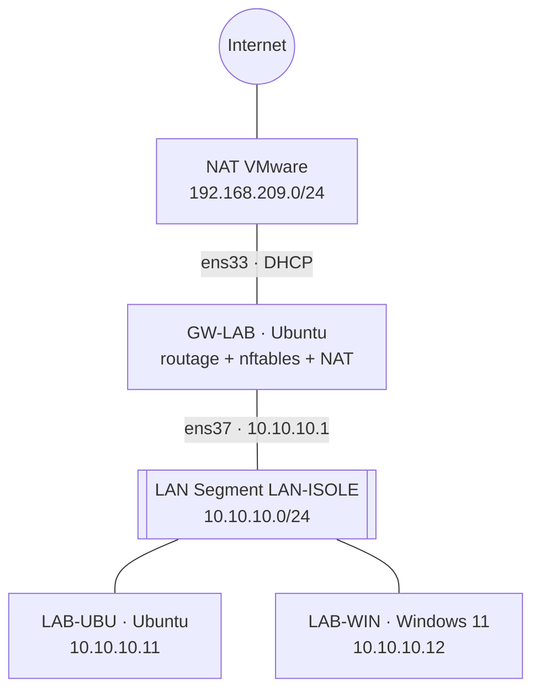

# 03 — Réseau virtuel isolé avec passerelle filtrante (nftables)

## Objectif
Construire un labo de test où l'on peut casser des choses sans risque : réseau virtuel coupé d'Internet, de l'hôte et du réseau physique, avec une **seule** passerelle Linux qui ouvre un accès contrôlé.

## Architecture

**Pourquoi un LAN Segment** : comparé aux modes Bridged, NAT et Host-only, c'est le seul type de réseau VMware sans DHCP, sans lien avec l'hôte et sans sortie Internet.

## Réalisation
- 2 VM créées en **clones liés** à partir d'un snapshot de base (rapides, légères).
- GW-LAB : 2 cartes, netplan, `net.ipv4.ip_forward=1` persistant, pare-feu nftables.
- Postes du labo : une seule carte, IP fixe, passerelle 10.10.10.1 (Ubuntu via netplan, Windows via PowerShell).

## Politique de filtrage — « tout est interdit, sauf… »
Fichier complet : [`nftables.conf`](nftables.conf)

| Chaîne | Règle | Décision |
|---|---|---|
| input | politique par défaut | **drop** |
| input | loopback, connexions établies, ICMP et SSH depuis le labo | accept |
| forward | politique par défaut | **drop** |
| forward | réponses (established, related) | accept |
| forward | labo → réseaux privés RFC 1918 (box, hôte, LAN physique) | **drop** (placé avant les autorisations) |
| forward | labo → Internet en UDP 53, TCP 80/443 | accept |
| nat | masquerade sur ens33 | traduction |

## Tests d'isolation
| Test | Résultat |
|---|---|
| **A — passerelle éteinte** : ping 8.8.8.8 / box depuis le labo | ❌ « Destination Host Unreachable » → isolation totale |
| A : ping entre postes du labo | ✅ |
| **B — passerelle allumée** : HTTPS (`wget`, `Test-NetConnection -Port 443`) | ✅ DNS + HTTPS passent |
| B : ping Internet, accès à la box 192.168.1.1 | ❌ paquets silencieusement rejetés |

Analyse fine des résultats : sous Windows, un « Impossible de joindre l'hôte » est compté comme paquet *reçu* ; un timeout (paquet jeté par le pare-feu) n'a pas la même cause qu'un « Host Unreachable » (pas de passerelle).

## Pistes d'amélioration
Journalisation des refus (`log` nftables) · SSH limité à l'IP du formateur · DHCP (dnsmasq) côté labo · snapshots de remise à zéro du labo.

## Compétences
Segmentation et isolation · Linux comme routeur · **pare-feu nftables à états** · NAT masquerade · méthodologie de test et interprétation des résultats
